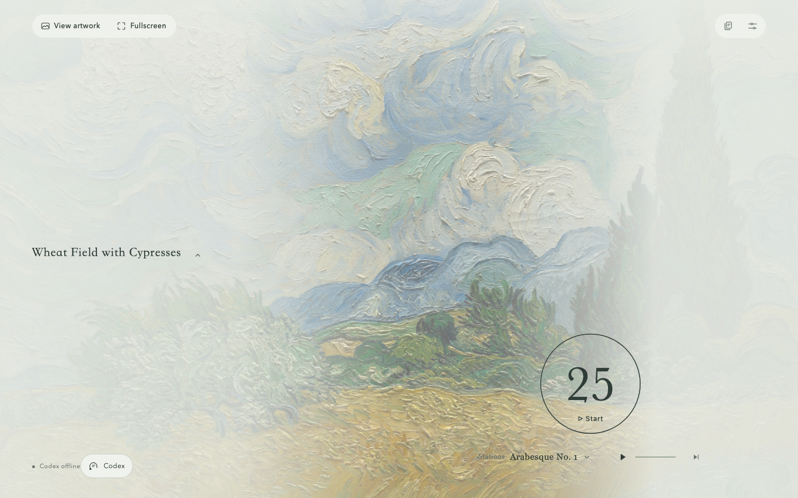

<div align="center">

# Agent FM

**A little company for the work ahead.**

Art, music, and a quiet place to spend time with your Agent.

[Get started](#get-started) · [Meet the space](#a-room-for-your-next-25-minutes) · [For Agents](#for-agents) · [简体中文](README.zh-CN.md)

[](https://github.com/phronesis-io/agent-fm/actions/workflows/check.yml)
[](LICENSE)

</div>



<sub>Actual interface, with details folded and the companion offline. Artwork: Vincent van Gogh, <a href="https://www.metmuseum.org/art/collection/search/436535">Wheat Field with Cypresses</a>, The Metropolitan Museum of Art, Open Access.</sub>

## A room for your next 25 minutes

Open FM while you write, study, read, or work. A painting or photograph fills the screen. A piece of music accompanies it. Start a Pomodoro, or leave the clock alone and stay a while.

Your Agent has a place here, too: a lasting conversation you can return to, with the artwork, sound, and time you've spent in FM as shared context. Invite it in when you feel like talking. The rest of the time, the space can be quiet.

- **A clock you can see at a glance.** During a Pomodoro, pausing the clock pauses the music. Resume both when you're back. Completion reminders run locally.
- **Art and sound, selected together.** Browse 335 local pairings, from museum works to contemporary photography and digital art. Piano, ambient, acoustic, jazz, beats, electronic, and game-inspired selections sit alongside optional YouTube radio.
- **One gesture to move on.** Skip to another pairing, save a favourite, or queue something for the next Pomodoro. Preparing the next selection leaves the current one playing.
- **Originals first.** Read sourced descriptions in their original language. Switch to a translation in the same place, then back. Personal interpretation belongs in the conversation you choose to open.
- **A companion with continuity.** FM keeps one dedicated Codex chat across visits. You can also opt into Agent selection for the next set; it is off by default.

**Desktop preview · macOS tested · Codex companion**

The current companion integration is Codex. Other Agents can work through the CLI to prepare programmes; other companion hosts, mobile access, and community publishing are not implemented yet.

## Get started

You'll need **Node.js 24 or 25**, an authenticated **Codex** installation, and a desktop browser. See [installation and compatibility](INSTALL.md) for details.

Tell Codex:

```text
Install Agent FM from https://github.com/phronesis-io/agent-fm.
Read INSTALL.md, set it up locally, and open it for me.
Ask which language I'd like to use.
```

Or install from your terminal:

```sh
git clone https://github.com/phronesis-io/agent-fm.git
cd agent-fm
npm ci
npm run build
node dist/cli.mjs install
node dist/cli.mjs open
```

The repository includes its local art and music: allow roughly **600 MB** before dependencies. Installation adds the Codex Skill and local launcher. FM remembers its local address across restarts; music begins after a click.

On your first visit, confirm your working language, choose a sound, and start a clock when you're ready. English is the default interface, with Simplified Chinese also supplied. You can change the language in settings; it does not determine which cultures you encounter.

## Local space, optional AI

FM runs a small process on your computer and opens in your browser. It has **no central FM backend and no separate FM account**.

| Stays on your computer | Uses an external service |
| --- | --- |
| Timer, playback of bundled media, saved pairings, and FM's local activity records | Codex requests use your existing account and service. Relevant FM context accompanies those requests. |
| The local bridge listens on `127.0.0.1` | YouTube stations use official embeds and need an internet connection. |

Companion context is limited to **FM selections, artworks, timers, and chats**. FM does not watch your other applications. The timer and local playback do not need a model response. Optional automatic Agent features have call budgets; the in-app ledger shows model use.

For data locations, login recovery, upgrades, and removal, see [INSTALL.md](INSTALL.md).

## For Agents

The installer provides a Skill and a discoverable CLI. With `~/.local/bin` on your `PATH`:

```sh
agent-fm capabilities
agent-fm schema "program prepare"
agent-fm language get
agent-fm context read
```

An Agent can read bounded FM context, prepare a programme with sources, and queue it for the next Pomodoro. It should confirm the listener's language and keep facts distinct from interpretation. Preparing content does not interrupt playback or grant another Agent control of the bound Codex conversation.

[CLI contract and implementation status](docs/AGENT-INTERFACE.md)

## Help shape the collection

A good pairing should hold up through a stretch of actual work. Suggestions for contemporary art, photography, instrumental music, and underrepresented cultural scenes are welcome.

[Open an issue](https://github.com/phronesis-io/agent-fm/issues) with the artwork and recording links, their creators and reuse terms, and a few specific words about why they belong together. For playback problems, include the pairing or station, your browser, and what happened. Keep personal chats and pairing tokens out of reports.

The collection currently contains **235 contemporary pairings and 100 earlier selections**, plus four YouTube radio seeds. Pairings reuse recordings; 335 pairings does not mean 335 distinct tracks. Full human audition and long-session listening review are ongoing. Community publishing inside FM is a future direction.

## Development

After installing dependencies and building:

```sh
npm run check
npm test
npx playwright install chromium
npm run test:browser
npm run package
```

Tests use isolated local stores and do not require real Codex calls. Media decoding and muted playback checks verify technical playback, not how a recording feels to work with. Platform and recovery limitations are tracked in [INSTALL.md](INSTALL.md#known-limits).

## Licence

Original software is [MIT-licensed](LICENSE). Art, recordings, and source descriptions retain their own licences; they are not covered by the code's MIT licence. See [per-asset credits and terms](THIRD_PARTY_NOTICES.md) before reusing them. YouTube content is played through official embeds and is not bundled.
