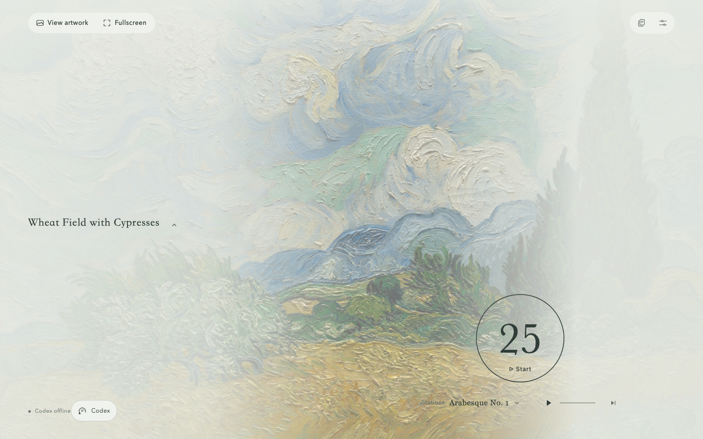

<div align="center">

# Agent FM

**和你的 Agent，一起度过一段时间。**

一幅画，一段声音，一个安静的工作空间。

[开始使用](#开始使用) · [English](README.md)

</div>



<sub>真实界面，说明已收起，陪伴会话处于离线状态。画作：梵高《麦田与柏树》，<a href="https://www.metmuseum.org/art/collection/search/436535">大都会艺术博物馆 Open Access</a>。</sub>

## 给接下来的 25 分钟一个地方

写作、学习、读书、工作时，打开 FM。画作或照片铺满屏幕，音乐在旁边。你可以开始一个番茄，也可以不计时，只待一会儿。

你的 Agent 也在这个空间里：一个可以不断回来的长期会话，以你在 FM 里看过的作品、选过的声音和度过的时间为共同上下文。想聊时邀请它，其余时间保持安静。

- **一眼可见的计时器。** 番茄钟与音乐一起暂停、一起继续，到点由本机提醒。
- **一起编选的画与声音。** 335 组本地搭配，包含馆藏作品、当代摄影和数字艺术；声音覆盖钢琴、环境、原声、爵士、节拍、电子和游戏氛围，也可选 YouTube 电台。
- **随时换一组。** 跳过、收藏，或为下一钟准备一组；准备下一组不会打断当前播放。
- **先看原文。** 有来源的作品说明默认保留原文，译文在同一位置切换。个人解读留给你主动打开的对话。
- **有延续的陪伴。** 每次回来都使用同一个专属 Codex 会话。也可以主动开启 Agent 为下一组选曲；默认关闭。

**桌面预览版 · 已在 macOS 测试 · 当前陪伴宿主为 Codex**

其他 Agent 可以通过 CLI 准备节目，但暂不能替代绑定的陪伴会话。其他陪伴宿主、手机访问和应用内社区发布尚未实现。

## 开始使用

需要 **Node.js 24 或 25**、已登录的 **Codex** 和桌面浏览器。详细兼容性见 [安装说明](INSTALL.md)。

把这段话发给 Codex：

```text
帮我安装 Agent FM：https://github.com/phronesis-io/agent-fm
先读 INSTALL.md，在本机安装并打开。
请确认我希望使用的交流语言。
```

也可以在终端执行：

```sh
git clone https://github.com/phronesis-io/agent-fm.git
cd agent-fm
npm ci
npm run build
node dist/cli.mjs install
node dist/cli.mjs open
```

仓库自带本地画作与音乐，安装依赖前约 **600 MB**。安装器提供 Codex Skill 和本地启动命令，重启后复用原地址。音乐需要点击后才会播放。

第一次进入时确认交流语言，选择声音，需要专注时开始计时。界面默认英语，也提供简体中文，可在设置中切换；语言偏好不决定你会接触哪些文化。

## 本机运行，按需邀请 AI

FM 在你的电脑上运行一个小进程，通过浏览器访问，**没有中心 FM 服务器，也无需注册 FM 账号**。

计时、本地媒体播放、收藏和 FM 活动记录在本机运行或保存。邀请 Codex 时，相关 FM 上下文会交给你现有账号使用的 Codex 服务；YouTube 电台通过官方嵌入播放器联网播放。

陪伴上下文仅限 **FM 内的选台、作品、计时和聊天**，不会监视其他应用。计时器和本地播放不等待模型回复。可选的自动 Agent 功能有调用预算，应用内可查看模型使用记录。

数据位置、登录后自动启动、升级与卸载见 [INSTALL.md](INSTALL.md)。

## 面向 Agent

安装后，将 `~/.local/bin` 加入 `PATH`，即可查看 CLI 的能力和参数：

```sh
agent-fm capabilities
agent-fm schema "program prepare"
agent-fm language get
agent-fm context read
```

Agent 可以读取有限的 FM 上下文、准备带来源的节目，再排入下一钟。先确认用户语言，区分事实与解读；准备节目不会中断播放，也不授予其他 Agent 接管 Codex 会话的权限。详见 [接口与实现状态](docs/AGENT-INTERFACE.md)。

## 一起把内容做好

好的搭配，应该经得起一段真实的工作时间。欢迎推荐当代艺术、摄影、无歌词音乐，以及尚未充分呈现的文化内容。

可以[提交 Issue](https://github.com/phronesis-io/agent-fm/issues)，附上作品与录音链接、创作者和使用授权，并具体说说为什么把它们放在一起。播放问题请附节目或电台、浏览器及实际现象；不要附个人聊天或配对凭据。

目前有 **235 组当代搭配、100 组早期编选和 4 个 YouTube 电台入口**。不同搭配会复用录音，335 组不等于 335 首不同的音乐。完整人工试听与长时间使用反馈仍在进行；应用内社区发布尚未开放。

开发命令见 [英文 README](README.md#development)。原始软件采用 [MIT](LICENSE)；图片、录音和资料文字保留各自授权，请查阅[逐项署名与使用条款](THIRD_PARTY_NOTICES.md)。YouTube 内容不包含在仓库内。
